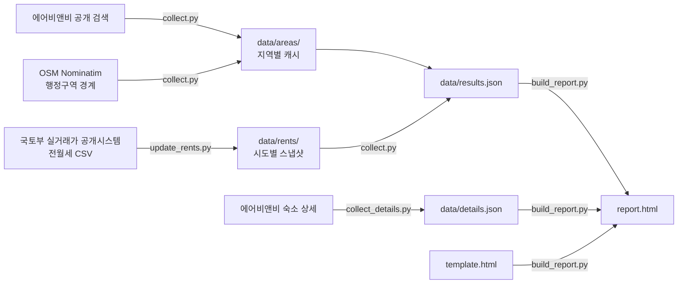

# 에어비앤비 수익성 검토

지역과 임차 예산을 넣으면 월 순이익, 기대 임차 횟수, 초기 세팅비 회수 일정을 보여 주는 단일 페이지 리포트입니다.
에어비앤비 공개 검색 화면의 숙소 요금과 국토부 전월세 실거래가를 결합해 만듭니다.

- API 키, 로그인, LLM API를 쓰지 않습니다. 파이썬 3.11 표준 라이브러리만 사용합니다.
- 결과물은 데이터가 들어 있는 HTML 한 파일(`report.html`)입니다. 더블클릭으로 열립니다(지도 배경만 인터넷 연결 필요).
- 수치는 가정에 따라 크게 달라지는 1차 검토용이며 투자 권유가 아닙니다.

## 목차
1. [빠른 시작](#빠른-시작)
2. [구성과 데이터 흐름](#구성과-데이터-흐름)
3. [파일별 설명](#파일별-설명)
4. [데이터 형식](#데이터-형식)
5. [계산 방법](#계산-방법)
6. [설정값과 바꾸는 법](#설정값과-바꾸는-법)
7. [GitHub Actions](#github-actions)
8. [다른 용도로 재사용하기](#다른-용도로-재사용하기)
9. [알려진 한계와 개선 과제](#알려진-한계와-개선-과제)
10. [수정 후 확인 방법](#수정-후-확인-방법)
11. [문제 해결](#문제-해결)

## 빠른 시작

리포트만 볼 때:

```
report.html 을 더블클릭
```

데이터를 새로 받을 때(PC, 한국 IP 권장):

```
git pull
python update_rents.py           # 국토부 월세 스냅샷 (오늘 받지 않은 것만 다시 받음)
python collect.py --refresh      # 에어비앤비 검색 결과 (약 20분)
python collect_details.py        # 숙소 상세 (약 15분)
python build_report.py           # report.html 생성
```

서울 외 시군구를 추가할 때:

```
python collect.py --add "부산광역시 기장군" --add "충청남도 공주시"
python update_rents.py
python collect.py
python collect_details.py
python build_report.py
```

시도 이름은 국토부 실거래가 공개시스템 표기를 그대로 씁니다(예: 부산광역시, 강원특별자치도, 전북특별자치도, 전남광주통합특별시).
추가한 지역은 `areas_extra.json`에 저장됩니다. GitHub에서는 Refresh data를 수동 실행할 때 "추가할 시군구"에 입력하면 됩니다.

## 구성과 데이터 흐름



- 수집(파이썬)과 계산·화면(브라우저의 자바스크립트)이 나뉘어 있습니다. 파이썬은 원자료만 모으고, 월 순이익 같은 숫자는 `template.html` 안에서 사용자가 넣은 조건으로 계산합니다.
- `data/results.json`과 `data/details.json`만 있으면 `build_report.py`로 리포트를 다시 만들 수 있습니다. 화면만 고칠 때는 수집을 다시 할 필요가 없습니다.
- 저장소에 올리는 것: 코드, `data/results.json`, `data/details.json`, `data/rents/`, `report.html`. 올리지 않는 것: `data/areas/`, `data/details/`(다시 받을 수 있는 캐시).

## 파일별 설명

| 파일 | 역할 | 접속하는 곳 |
|---|---|---|
| `update_rents.py` | 국토부 전월세 실거래(연립다세대·단독다가구, 최근 183일)를 받아 신규 월세 계약만 추려 `data/rents/<시도>_<유형>.csv.gz`로 저장 | rt.molit.go.kr |
| `collect.py` | 지역별 에어비앤비 검색 결과 수집, 월세 스냅샷과 결합해 `data/results.json` 생성 | airbnb.co.kr, nominatim.openstreetmap.org |
| `collect_details.py` | 지역·침실 수별로 후기가 많은 숙소의 상세 페이지에서 최대 인원, 항목별 평점, 후기 주제, 주의 고지를 모아 `data/details.json` 생성 | airbnb.co.kr |
| `build_report.py` | 두 JSON을 `template.html`의 `/*__DATA__*/null` 자리에 넣어 `report.html` 생성 | 없음 |
| `template.html` | 화면과 모든 계산(자바스크립트). 외부 의존은 지도용 Leaflet과 Esri 타일뿐 | 브라우저에서 unpkg.com, arcgisonline.com |
| `areas_extra.json` | `--add`로 추가한 시군구 목록(없으면 파일도 없음) | |

### collect.py의 흐름
1. `all_areas()`가 서울 동 단위(`SEOUL_DONGS`)와 서울 외 시군구(`SIGUNGU` + `areas_extra.json`)를 합칩니다.
2. `collect_area()`가 지역마다 검색 범위를 정합니다.
   - 동 단위: 에어비앤비에 영문 지명(`slug`)으로 한 번 검색해 중심 좌표를 얻고, 사방 약 700m 사각형을 범위로 씁니다.
   - 시군구 단위: `boundary()`가 OSM Nominatim에서 행정경계 다각형을 받고, 그 외접 사각형을 범위로 씁니다. 검색 결과 중 다각형 밖 숙소는 `inside()`로 걸러냅니다.
3. 범위 안에서 날짜 두 구간(`WINDOWS`: 약 6주 뒤 평일 2박, 주말 2박)을 지도 범위 검색으로 읽습니다. `parse_search()`가 페이지에 들어 있는 JSON(`data-deferred-state-0`)에서 숙소를 뽑습니다.
4. `merge_listings()`가 같은 숙소를 하나로 합치고, 여러 지역에 걸리면 중심이 가장 가까운 지역에 배정합니다.
5. `load_rents()`가 `data/rents/` 스냅샷에서 지역별 신규 월세 계약을 붙입니다.

### 종료 코드
`collect.py`와 `update_rents.py`는 "코드 오류"와 "대상 사이트에 접속하지 못함"을 구분합니다.

| 코드 | 뜻 | GitHub Actions의 처리 |
|---|---|---|
| 0 | 정상 | 커밋 |
| 75 | 접속 실패 또는 수집량이 비정상적으로 적음(지역 5곳 미만 또는 숙소 300곳 미만). 기존 결과를 덮어쓰지 않음 | 새 러너에서 재시도 |
| 1 | 오류, 또는 스냅샷이 너무 오래됨 | 실패로 표시 |

## 데이터 형식

### data/results.json
```
meta:  collected_at, windows[{label, checkin, nights}], rent_from, rent_to, rent_saved, pages, guests
areas: [{
  name, unit("동" | "시군구"), sido, gu, dongs[], center[lat, lng], bbox[남, 북, 서, 동],
  collected_at, windows,
  listings: [{ id, title, name, lat, lng, rating, reviews, is_new, guest_fav,
               bedrooms, info, prices{weekday, weekend}, nightly, area, url }],
  rents:    [[면적㎡, 보증금(만원), 월세(만원), 유형, 시군구·동, 도로명, 건축년도, 계약년월], ...]
}]
```
- `prices`는 그 날짜 구간의 결제 총액을 박 수로 나눈 1박 요금(원)입니다. 한 구간에만 노출된 숙소는 그 값만 있습니다.
- `info`는 검색 카드의 구성 문구입니다(예: `침실 2개 · 퀸사이즈 침대 3개 · 욕실 1개`). 최대 인원 추정에 씁니다.
- `build_report.py`가 상세 정보가 있는 숙소에 `cap`(최대 인원)과 `d`(아래 details)를 덧붙입니다.

### data/details.json
```
{ 숙소 id: { cap, cat{청결도, 정확도, 체크인, 의사소통, 위치, 가격 대비 만족도},
            low(별점 1~3점 비율), n(후기 수), tags{주제: 언급 수},
            safety[주의 고지 문구], elev(엘리베이터 표기), parking(주차 표기, 인근·노상 포함) } }
```

### data/rents/
- `<시도>_<유형>.csv.gz`: 열은 `sgg, area, deposit_man, rent_man, road, built, ym`. 신규 월세 계약만 들어 있습니다.
- `meta.json`: 스냅샷별 `saved_at, rent_from, rent_to, rows`. 갱신 여부는 `saved_at` 기준으로 판단합니다.
- gzip은 `mtime=0`으로 써서 내용이 같으면 파일도 같습니다(불필요한 커밋 방지).

## 계산 방법

모든 계산은 `template.html`의 `evalTier()`에 있습니다.

| 항목 | 식 |
|---|---|
| 1박 요금 | 평일 중앙값 × 5 + 주말 중앙값 × 2, 7로 나눔 |
| 월 매출 | 1박 요금 × 30.4일 × 가동률 |
| 월 순이익 | 월 매출 − 운영비·수수료(매출 × 비율) − 월세 |
| 기대 임차 횟수 | 30.4 × 가동률 ÷ 평균 숙박일 |
| 세팅비 회수 | 초기 세팅비 ÷ 월 순이익 (보증금은 돌려받는 돈이라 제외) |
| 연 수익률 | 월 순이익 × 12 ÷ (보증금 + 초기 세팅비) |
| 손익분기 가동률 | 월세 ÷ (1박 요금 × 30.4 × (1 − 운영비 비율)) |

월세와 보증금은 "예산 한도 안, 해당 집 크기"인 신규 월세 계약의 중앙값입니다.

화면에 숨어 있는 판단 기준:

| 기준 | 값 | 위치 |
|---|---|---|
| 집 크기와 침실 수 대응 | 33㎡ 미만 → 1개, 33~55㎡ → 2개, 55㎡ 이상 → 3개 이상 | `TIERS`, `bucket()` |
| 초저가 계약 제외 | 환산 월 비용이 ㎡당 4,500원 미만이면 공공임대·특수거래로 보고 제외 | 스크립트 맨 위 `dropped` |
| "구할 만한 크기" | 예산 내 계약이 5건 이상이고 그 크기 계약의 30% 이상일 때만 자동 선택 후보 | `evalTier()`의 `common` |
| 표본 최소 | 비교 숙소 5곳, 예산 내 계약 3건 | `MIN_N`, `feasible` |
| 최대 인원 추정 | 퀸·킹·더블·이층 2명, 싱글·소파 1명, 종류 없는 "침대 N개"는 확인된 숙소로 보정한 계수(1.2~2.2) | `beds()`, `calib` |
| 회수 일정 시나리오 | 가정 가동률 ±15%p, 36개월 | `drawPayback()`, `MONTHS` |

## 설정값과 바꾸는 법

| 바꾸고 싶은 것 | 고칠 곳 |
|---|---|
| 서울 동 추가 | `collect.py`의 `SEOUL_DONGS`에 `{name, slug, gu, dongs}` 추가. `slug`는 에어비앤비가 인식하는 영문 지명(`Yeonnam-dong--Mapo-gu--Seoul` 형식). 한글 검색어는 지역으로 인식되지 않습니다. 실행하면 "인식된 장소"가 출력되니 맞는지 확인하세요. |
| 서울 외 시군구 추가 | `python collect.py --add "시도 시군구"` 또는 `SIGUNGU` 목록 |
| 동 단위 검색 범위 | `BOX_LAT`, `BOX_LNG` (기본 사방 약 700m) |
| 지역당 표본 수 | `PAGES`(동 단위 쪽수, 1쪽 18곳), `MAX_PAGES`·`TARGET`(시군구 단위) |
| 요금 기준일 | `_base`(오늘 + 42일), `WINDOWS`(요일·박 수). 성수기 요금을 보려면 구간을 추가하고 `template.html`의 `nightly()` 가중치를 함께 고칩니다. |
| 게스트 수 | `search()`의 `adults` (기본 2명) |
| 월세 기간·유형 | `update_rents.py`의 `RENT_FROM`, `TYPES`(아파트를 넣으려면 `"아파트": "A"` 추가. 아파트 CSV는 열 이름이 달라 `parse()` 확인 필요) |
| 스냅샷 갱신 주기 | `update_rents.py`의 `MAX_AGE`와 워크플로의 `max_age` 기본값 |
| 상세를 볼 숙소 수 | `collect_details.py`의 `PER_BUCKET`(지역·침실 수별), `WORKERS` |
| 화면 기본값 | `template.html`의 입력 요소 `value`(보증금 2000, 월세 100, 가동률 55, 숙박 3박, 운영비 30, 세팅비 1000) |
| 첫 화면 범위 | 스크립트 끝의 `$('#fScope').value = ...` (기본 서울) |
| 지도 타일 | `initMap()`의 `L.tileLayer(...)`. OSM 기본 타일은 `file://`로 연 페이지를 차단하므로 쓰지 않습니다. |

## GitHub Actions

| 워크플로 | 언제 | 하는 일 |
|---|---|---|
| **Update rents** | 매일 02:00 (한국 시간) | 월세 스냅샷을 모두 다시 받아 `data/rents/`에 커밋. 오늘 이미 받은 것은 건너뜀 |
| **Refresh data** | 매일 03:00 | 에어비앤비 요금·숙소 상세를 새로 수집해 `data/`와 `report.html` 커밋 |
| **Build and publish report** | 푸시할 때, Refresh data가 끝났을 때 | 리포트를 다시 만들어 검사하고, GitHub Pages가 켜져 있으면 배포 |

구조상 알아둘 점:
- **재시도 구조**: `refresh.yml`과 `update-rents.yml`은 `*-once.yml`을 최대 3번 호출합니다. 호출마다 새 러너(새 IP)에서 돌기 때문에, 한 러너에서 접속이 안 되어도 다음 시도에서 될 수 있습니다. 종료 코드 75가 "다음 러너에서 재시도" 신호입니다.
- **국토부 접속은 러너에서 불안정합니다**: GitHub 러너는 해외 IP라 연결이 됐다 안 됐다 합니다. 그래서 받은 것만 커밋하고 다음 실행이 이어서 받습니다. 스냅샷이 7일 넘게 갱신되지 않으면 Update rents가 실패로 표시되고, 그때는 PC에서 `python update_rents.py`를 실행해 푸시하면 됩니다.
- **봇 커밋은 push 이벤트를 일으키지 않습니다**: 그래서 Build and publish report는 `workflow_run`으로 Refresh data의 완료를 받습니다.
- **동시 실행 방지**: 저장소에 커밋하는 워크플로는 `concurrency: repo-write` 그룹으로 순서대로 돕니다. 커밋 전에 `git pull --rebase`를 합니다.
- **Pages**: 저장소 Settings → Pages → Source에서 GitHub Actions를 선택하면 `https://<계정>.github.io/<저장소>/`에 배포됩니다. 꺼져 있으면 배포 단계만 건너뜁니다.

## 다른 용도로 재사용하기

- **국토부 실거래가 받기만 필요할 때**: `update_rents.py`의 `session()`, `download()`, `parse()`는 독립적입니다. `srhThingNo`(A 아파트, B 연립다세대, C 단독다가구, D 오피스텔)와 `srhDelngSecd`(1 매매, 2 전월세)를 바꾸면 다른 자료를 받습니다. 시도 단위는 한 번에 최대 1년, 하루 100회 제한이 있습니다.
- **행정구역 경계와 점 포함 판정**: `collect.py`의 `boundary()`와 `inside()`는 다른 좌표 데이터에도 그대로 쓸 수 있습니다. Nominatim은 초당 1회 이하로 호출해야 합니다.
- **"데이터를 넣은 단일 HTML" 패턴**: `build_report.py`와 `template.html`의 `/*__DATA__*/null` 치환 방식은 서버 없이 여는 리포트에 그대로 쓸 수 있습니다.
- **불안정한 사이트를 Actions로 수집하는 패턴**: `*-once.yml` + 종료 코드 75 + 스냅샷 누적 구조는 다른 수집 작업에도 옮겨 쓸 수 있습니다.
- **다른 도시·국가**: 에어비앤비 부분은 `slug`만 바꾸면 되지만 월세 부분(국토부)은 한국 전용입니다. `load_rents()`가 돌려주는 형식(`[면적, 보증금, 월세, 유형, 주소, 도로명, 건축년도, 계약년월]`)만 맞추면 다른 출처로 바꿀 수 있습니다.

## 알려진 한계와 개선 과제

정확도에 영향이 큰 순서입니다.

| 한계 | 지금 처리 | 개선 방향 |
|---|---|---|
| 가동률을 측정하지 못함 | 사용자가 넣는 가정값 | 숙소 달력의 예약 가능일을 주기적으로 기록해 예약률 추정. 매일 실행 결과를 누적하면 가능 |
| 서울 외 시군구는 수익이 과대평가됨 | 한계로 고지, 첫 화면에서 제외 | 숙소가 몰린 읍면동만 골라 월세를 비교(`load_rents()`에서 숙소 좌표 기준으로 동 필터) |
| 요금이 한 시점(약 6주 뒤)뿐 | 평일·주말 두 구간 | 성수기·비수기 여러 구간 수집, 누적 저장으로 계절성 반영 |
| 상위 노출 숙소 위주 표본 | 한계로 고지 | 신규 숙소(`is_new`)의 요금을 따로 집계해 "신규 진입 시 요금" 제시 |
| 후기 원문을 읽지 못함 | 에어비앤비가 집계한 평점·주제만 사용 | 후기 본문 접근 방법이 생기면 `collect_details.py`의 `parse()`에 추가 |
| 인근 관광지 정보 없음 | 미구현 | 한국관광공사 TourAPI 등 키가 있는 공식 API 연동 |
| 최대 인원이 일부만 실제 값 | 침대 수로 추정, 화면에 "(추정)" 표시 | `PER_BUCKET`을 늘리거나 검색을 인원수별로 나눠 수집 |
| 초저가 계약 제외 기준이 어림값 | ㎡당 4,500원 고정 | 지역별 분포 기준(예: 하위 5%)으로 변경 |
| 등록 가능 여부를 판단하지 않음 | 한계로 고지 | 건축물대장 용도 확인 절차 안내 또는 연동 |
| 에어비앤비 페이지 구조에 의존 | `parse_search()`가 내장 JSON 경로를 직접 읽음 | 구조가 바뀌면 이 함수만 고치면 됨. 저장해 둔 HTML로 회귀 테스트 추가 |
| 자동 테스트 없음 | 수동 확인 | `parse_search`, `inside`, `load_rents`, `evalTier`에 고정 입력 테스트 추가 |
| 스냅샷 커밋으로 저장소가 커짐 | 매일 갱신. 압축 파일이라 매번 통째로 쌓여 연 약 700MB | 스냅샷을 압축하지 않은 CSV로 저장(변경분만 쌓임)하거나 릴리스 자산·별도 브랜치로 분리 |

## 수정 후 확인 방법

1. 문법: `python -m py_compile collect.py collect_details.py update_rents.py build_report.py`
2. 리포트 생성: `python build_report.py` 후 `report.html`을 열어 확인
3. 화면 자동 점검(브라우저 없이): 헤드리스 Chrome으로 렌더링 결과를 받아 오류를 확인합니다.
   ```
   chrome --headless=new --disable-gpu --virtual-time-budget=8000 --dump-dom file:///<경로>/report.html
   chrome --headless=new --disable-gpu --window-size=1280,2300 --screenshot=out.png file:///<경로>/report.html
   ```
   `template.html`을 고친 뒤에는 모든 지역 × 모든 집 크기를 한 번씩 선택해 예외가 없는지 보는 것이 좋습니다(`select(이름)`, `$('#fTier').value = ...; render()`).
4. 수집기를 고쳤다면 지역 하나로 먼저 시험합니다. `data/areas/`에서 해당 지역 파일을 지우고 `python collect.py`를 실행하면 그 지역만 다시 받습니다.
5. 워크플로를 고쳤다면 Actions 탭에서 수동 실행해 확인합니다. Update rents는 `max_age=0`, `limit=2`로 실행하면 짧게 시험할 수 있습니다.

## 문제 해결

| 증상 | 원인과 조치 |
|---|---|
| 지도에 "ACCESS BLOCKED" | OSM 기본 타일을 `file://`에서 쓸 때 생깁니다. `initMap()`의 타일 주소가 Esri인지 확인 |
| "[건너뜀] 에어비앤비가 장소를 인식하지 못함" | `slug`가 틀렸습니다. 에어비앤비에서 그 지역을 검색했을 때 주소창에 나오는 영문 지명을 넣으세요 |
| "[건너뜀] 행정구역 경계를 찾지 못함" | 시군구 이름이 OSM 표기와 다릅니다. `boundary()`의 검색어를 확인 |
| "월세 스냅샷이 없는 시도" | 새 시도를 추가한 직후입니다. `python update_rents.py` 실행 |
| 수집량이 갑자기 0에 가까움(종료 코드 75) | 에어비앤비 차단 또는 페이지 구조 변경. `parse_search()`가 `None`을 돌려주는지 확인 |
| 국토부 다운로드가 "CSV가 아닌 응답" | 일일 100회 제한 또는 일시 오류. 다음 날 다시 실행 |
| Refresh data의 푸시가 거절됨 | 실행 중에 main이 바뀐 경우입니다. 워크플로가 `git pull --rebase` 후 푸시하므로 다시 실행하면 됩니다 |

## 자료 출처와 이용 시 주의
- 에어비앤비: 로그인 없이 보이는 공개 검색·상세 화면. 요청 간격을 두고(1.5초) 지역당 수십 건만 읽습니다. 요청량을 크게 늘리지 마세요.
- 국토부 실거래가 공개시스템: 공식 CSV 다운로드 기능. 참고용 자료이며 신고 시점에 따라 내용이 바뀔 수 있습니다.
- OpenStreetMap Nominatim: 행정경계 조회. 이용 정책에 따라 초당 1회 이하로 호출합니다.
